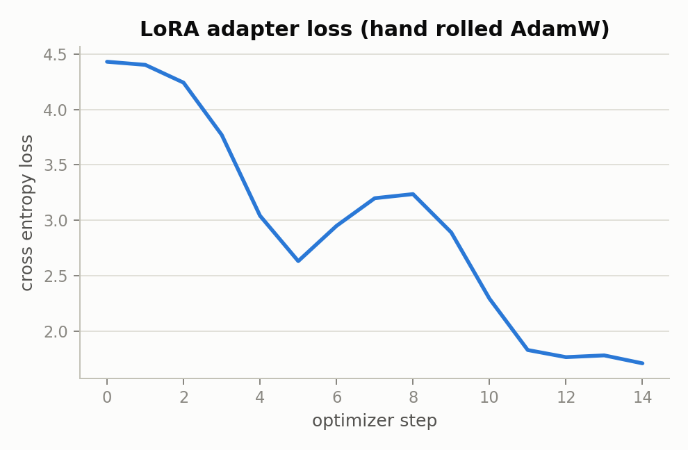
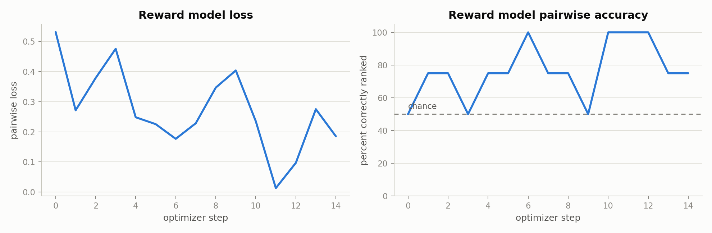
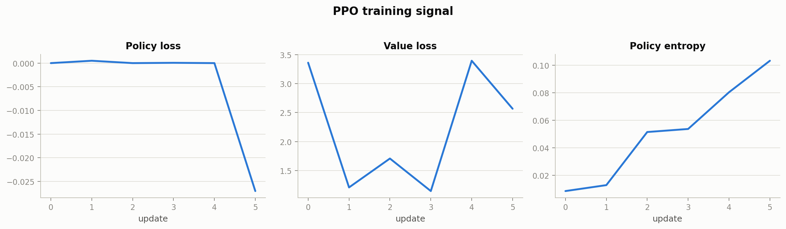
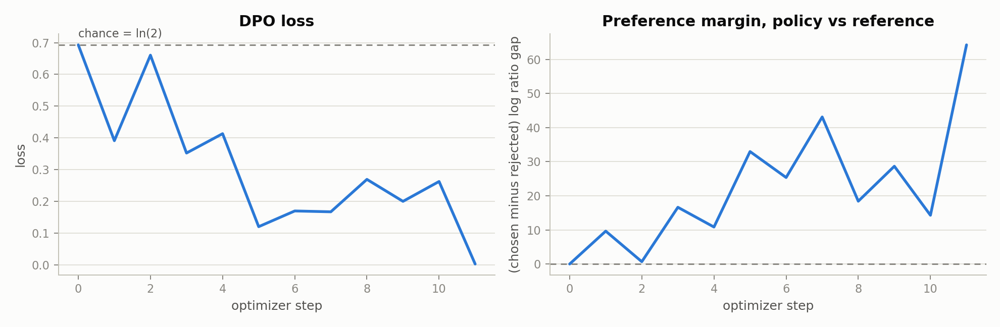

# Results

Every number and chart on this page comes from one run of
`python run_pipeline.py` against real DistilGPT2 on a laptop CPU (about a
minute end to end), with `numpy` and `torch` seeded to zero. The full
machine readable output is committed at `assets/results.json`. Two
consecutive runs on the same machine produced byte identical results; a
different PyTorch version or CPU may shift the numbers slightly.

Read this page alongside `docs/TRADEOFFS.md`, which explains why each setup
choice was made. This page covers what happened once those choices were in
place.

## A correction to an earlier version of this page

An earlier version reported a 33% in domain versus 17% out of domain win
rate and read the gap as evidence of a generalization boundary. That gap
was an artifact. Both models produced identical output (a run of newline
characters) on several prompts, the win rate counts a tie as half a win,
and the aligned model lost every comparison that was not a tie. The 33%
and 17% were just the number of tied prompts (four and two, out of six).

The cause was a set of pipeline bugs, all fixed in the current code:

- Supervised finetuning used the `### Instruction / ### Response` template,
  but the reward model, PPO, DPO and evaluation all used raw prompts, so
  the model was mostly evaluated on a format it was never finetuned on. Every
  stage, including `chat()`, now uses the one SFT template.
- Responses had no end of sequence token, so the model never learned to
  stop. EOS is now appended to SFT and DPO responses.
- DPO's prompt masking counted one token too many: the prompt prefix ended
  in a space that BPE merges into the first response word, so the first
  response token was silently excluded from every log probability. The
  pipeline now asserts that the prompt tokens are an exact prefix of the
  full sequence.
- The evaluation scored the prompt twice (completion text already included
  it), and only reported the tie-inflated win rate. It now scores the
  continuation only and reports wins, ties and losses separately.
- PPO recomputed advantages from the value head after each inner update,
  ran with dropout on (so the importance ratio was not exactly one before
  the first update), and did not normalize advantages. All three are fixed.

## Supervised finetuning

Training loss drops from 4.95 to 0.001 over 36 optimizer steps (12 epochs
of a five example training set, batch size two). Validation loss, measured
on the single held out example, is 5.64. That is what memorizing five
examples looks like: the model reproduces them almost exactly and learns
nothing that transfers to an unrelated sixth.

After finetuning, the templated prompt "What is the capital of Japan?"
produces "The capital of Japan is Tokyo." and then stops, because the
response now ends in an EOS token the model has learned to emit. The
untuned base model, given "Hello, how are you?", produces only newline
characters, which is typical of a GPT-2 family model that was never
instruction tuned.

## LoRA correctness demo

Before training, the run checks that a zero initialized `B` matrix makes
`lora_linear_forward`'s output identical to the frozen base projection
(`True` in `assets/results.json`). This is the property that lets LoRA
start training from the base model's exact behavior. The adapter (rank 8,
alpha 16, wrapped around the real `lm_head` weight) is then trained for 15
steps using only the hand written AdamW, linear warmup and gradient
clipping in `rlhf/optim.py`, with gradients averaged across two micro
batches by `accumulate_gradients`. Loss falls from 4.43 to 1.71.

The base model reports zero trainable parameters after
`freeze_base_params`; the adapter alone is 408,200 parameters, 0.50% of the
combined total. After training, `merge_lora`'s folded weight matches the
unfolded forward pass to within 1e-5 (`True`), so the merge is exact.

An earlier configuration (learning rate 0.05, three warmup steps) spiked
the loss from about 2.2 to over 19 before recovering. Lowering the learning
rate to 0.01 and extending warmup to five steps gives the smooth curve
above.

## Reward model

The reward model is a trained linear head on a frozen, separately
snapshotted copy of the finetuned backbone. Pairwise loss falls from 0.53
to 0.19 over 15 steps (five epochs of a twelve example preference set,
batch size four), with substantial batch to batch noise. Pairwise accuracy
on each four pair batch moves between 50% and 100% and ends at 75%. Even
though the six underlying pairs have an obvious quality gap ("The capital
of France is Paris." against "I do not know."), a linear head on frozen
features does not separate them reliably in fifteen steps. The evaluation
section below shows what that means for its use as a judge.

Raw scores have no fixed scale under a Bradley Terry loss. On the
preference training set they have mean -10.81 and standard deviation 2.37,
and every later use standardizes against those statistics.

## PPO

Three templated prompts are sampled with temperature 0.8 and top-k 50,
scored by the standardized reward model, and used for two inner PPO epochs
each (six updates). Normalized rewards for the three rollouts were 2.25,
2.13 and -0.24.

The policy loss stays near zero (0.000 to -0.027), which is expected here:
dropout is off, so the importance ratio is exactly one on the first inner
epoch, and normalized advantages have mean zero, so the clipped surrogate
starts at zero and moves only as far as one small update allows. Value loss
moves between 1.1 and 3.4 with no clear trend, because a value head trained
from scratch for six steps has not fit anything yet. Entropy rises from
0.008 to 0.103: supervised finetuning left the policy almost deterministic
on these prompts, and PPO's entropy bonus and updates spread it slightly.

This section shows that the PPO objective (per token KL shaping, GAE, the
clipped surrogate, value loss and entropy bonus) is wired correctly and
produces finite gradients end to end. Six updates are not enough to train a
policy, with this or any implementation.

## DPO, and a comparison against IPO, KTO, ORPO, and SimPO

DPO trains a fresh copy of the finetuned model against a frozen reference
copy for twelve steps (four epochs of a twelve example preference set,
batch size four). Loss starts at 0.693, exactly `ln(2)`, the value at zero
separation between chosen and rejected, which is correct for a policy that
has not yet moved from its reference. Loss ends at 0.002. The preference
margin (how much more the policy prefers chosen over rejected, relative to
the reference) is noisy from batch to batch, because each batch holds
different pairs, but trends upward from 0 to 64.2 on the final batch.

Only DPO is trained. IPO, KTO, ORPO and SimPO are evaluated once on the
final DPO batch to compare what each formula says about the same trained
result (`docs/TRADEOFFS.md` explains why). DPO is 0.0025, SimPO 0.0079,
KTO 0.055 and ORPO 5.09. IPO is 3,607, plotted on a log axis.

The large IPO value is expected. DPO's loss keeps shrinking as the margin
grows, with no ceiling, so nothing tells the optimizer to stop. IPO instead
regresses the margin toward a fixed target of `1 / (2 * beta)`, which is
5.0 at the beta of 0.1 used here. DPO pushed the margin to 64.2, and
`(64.2 - 5.0)^2 ≈ 3,505`. The observed 3,607 is slightly higher because IPO
averages the squared error per pair, and the mean of squares is at least
the square of the mean. So IPO is penalizing exactly the unbounded margin
growth it was designed to prevent, and that DPO allows.

KTO here is a simplified form without the paper's batch level reference
point; see the docstring in `rlhf/preference_optimization.py`.

## Evaluation: aligned model against the base model

The DPO trained model is compared with the untouched pretrained model on
two six prompt sets, using the frozen reward model as judge. Out of domain
prompts (`build_eval_prompt_set` in `rlhf/decoding.py`: the water cycle, a
thank you note, productivity tips) and in domain prompts
(`build_in_domain_eval_prompt_set` in `run_pipeline.py`: capital cities,
arithmetic, a science explanation, without repeating the training prompts):

| Split | Wins | Ties | Losses | Win rate |
|---|---|---|---|---|
| Out of domain | 5 | 0 | 1 | 83% |
| In domain | 4 | 0 | 2 | 67% |

These numbers should not be read as evidence that alignment helped or
generalized. The per prompt outputs in `assets/results.json` show the judge
is unreliable:

- It ranked the aligned model's correct "The capital of Italy is Rome."
  (score -10.92) **below** the base model's "The capital of Italy is the capital of
  Italy. The capital of Italy is the capital of Italy." (-10.23)
- It ranked an unrelated hallucination ("The National Center for Missing
  and Exploited Children…") **above** the base model's on topic, if
  generic, reply to "Write a short thank you note to a coworker."
- For "Recommend a book for someone who enjoys mystery novels." the aligned
  model replied with its memorized Romeo and Juliet summary from the SFT
  set, and the judge counted it as a win. It also counted "The freezing
  point of water at sea level in Celsius is Fahrenheit." as a win.

With six prompts per split and a linear head judge trained on six
preference pairs, the evaluation is a working harness, not a measurement.
What the samples do show is qualitative: the aligned model now answers in
short sentences and stops, sometimes correctly ("The capital of Italy is
Rome."), sometimes not ("3 + 5 is a research question."), and often falls
back on memorized training responses.

## Chat interface

With the system prompt "You are helpful." and the message "Say hi.", the
aligned model replies "The following figures from the Gallup Department of
State, January 1, 2014, were derived from the Gallup", an off topic
continuation from its pretraining data, cut at the 20 token limit.
Streaming the templated prompt "What is the capital of France?" token by
token yields "The capital of France is Paris." and then stops at EOS. That
pair appears verbatim in the preference dataset.

## What would change these numbers most

In rough order of expected impact:

1. **A real preference dataset** (HH-RLHF or similar) in place
   of six synthetic pairs. Every stage currently memorizes its data.
2. **A trustworthy judge.** A reward model trained on held out preference
   data and checked for pairwise accuracy on pairs it never saw, or an
   external LLM judge, plus a few hundred evaluation prompts instead of six.
3. **More PPO rollouts and updates**, so the value head can fit before its
   loss is interpreted.
4. **Finetuning the reward model's backbone** rather than only its head,
   once there is enough data that this does not immediately overfit.

None of these need an architectural change, only more data and compute.
